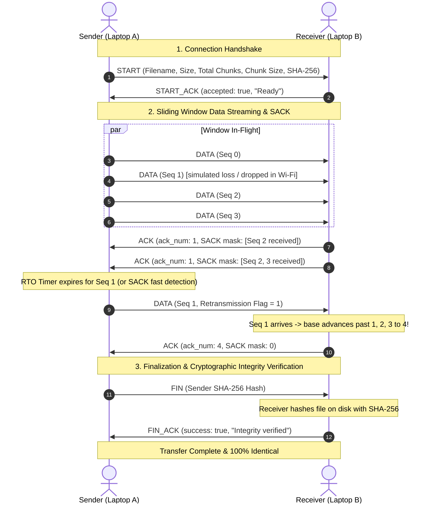

# Reliable File Transfer Protocol over UDP (RFTP)
> **Computer Networks Semester Project in Rust**  
> A high-performance, cross-platform application that transfers files reliably over local Wi-Fi networks using a custom protocol built on top of UDP. Includes a modern graphical user interface (GUI), CLI mode, automated test suite, and empirical TCP comparison benchmarks.

---

## 1. Project Overview & Motivation

### Why Raw UDP Cannot Guarantee Reliable Delivery
The standard **User Datagram Protocol (UDP)** (RFC 768) is a minimal, connectionless transport layer protocol. While fast and lightweight, standard UDP suffers from fundamental limitations when used for file transfers:
1. **Packet Loss**: UDP datagrams are transmitted as "best-effort". Intermediate routers, network buffers, or weak Wi-Fi signals can drop packets silently without notification.
2. **Packet Reordering**: UDP datagrams can travel through alternative routes or experience queuing delays, arriving at the receiver out of order.
3. **Packet Duplication**: Network switches or retries at the link layer can cause identical datagrams to be delivered more than once.
4. **Lack of Flow Control**: A fast sender can easily overwhelm the receiver's socket buffer, leading to severe buffer overflow drops.
5. **Lack of Inherent Error Recovery**: UDP checksums (optional in IPv4, mandatory in IPv6) only detect corruption by discarding the packet—they provide no mechanism to request retransmission of the lost data.

### How Our Protocol (RFTP) Solves These Limitations
To achieve 100% reliable file delivery over UDP, **RFTP** implements an end-to-end transport layer with:
- **3-Way Handshake (`START` / `START_ACK`)**: Negotiates file metadata (name, total size, total chunks, chunk size, and file SHA-256 hash).
- **Per-Packet CRC32 Checksums**: Detects bit-level corruption and drops invalid packets before processing.
- **Sliding Window Flow Control**: Allows multiple packets in-flight (`window_size`), maximizing throughput without buffer overflow.
- **Cumulative & Selective ACKs (SACK)**: Uses a 64-bit bitmask in the ACK header to acknowledge out-of-order packets individually.
- **Selective Repeat Retransmission & Dynamic RTO**: Retransmits only the exact missing chunks when a retransmission timeout (RTO) fires or when SACK indicates gaps.
- **End-to-End SHA-256 Verification**: Computes a cryptographic hash of the entire reconstructed file on disk and verifies it against the sender's pre-computed hash before concluding with `FIN` and `FIN_ACK`.

---

## 2. Architecture & Protocol Design

### Architecture Diagram

```
+---------------------------------------------------------------------------------+
|                                 APPLICATION                                     |
|    +-----------------------------+         +-------------------------------+    |
|    |    Desktop GUI (eframe)     |         |     CLI / Benchmark Engine    |    |
|    +--------------+--------------+         +---------------+---------------+    |
+-------------------|----------------------------------------|--------------------+
                    |                                        |
+-------------------|----------------------------------------|--------------------+
|                   v                                        v                    |
|           Transfer Controller & Background Worker Threads (Crossbeam Channels)  |
|                                                                                 |
|     +-------------------------+              +----------------------------+     |
|     |   File Chunker (Read)   |              |    File Writer (Write)     |     |
|     |  - Seekable random-acc  |              |  - Direct chunk positioning|     |
|     |  - SHA-256 pre-hash     |              |  - Post-transfer SHA check |     |
|     +------------+------------+              +-------------+--------------+     |
|                  |                                         ^                    |
|                  v                                         |                    |
|     +-------------------------+              +-------------+--------------+     |
|     |      Sender Window      |              |      Receiver Window       |     |
|     |  - In-flight buffer     |              |  - Cumulative base tracker |     |
|     |  - SACK bitmask parser  |              |  - SACK bitmask generator  |     |
|     |  - Per-chunk RTO timer  |              |  - Out-of-order buffer     |     |
|     +------------+------------+              +-------------+--------------+     |
+-------------------|----------------------------------------|--------------------+
                    |                                        ^
+-------------------|----------------------------------------|--------------------+
|                   v                                        |                    |
|     +---------------------------------------------------------------------+     |
|     |                     Packet Serializer / Deserializer                |     |
|     |             - RFTP Header (30 Bytes) + CRC32 verification           |     |
|     +---------------------------------+-----------------------------------+     |
|                                       |                                         |
|                                       v                                         |
|     +---------------------------------------------------------------------+     |
|     |                 ReliableUdpSocket (Loss Simulator Layer)            |     |
|     |             - Standard OS UDP Socket (std::net::UdpSocket)          |     |
|     +---------------------------------+-----------------------------------+     |
+---------------------------------------|-----------------------------------------+
                                        |
                          Wi-Fi Network (Local Hotspot)
```

---

### Protocol Packet Structure (30-Byte Header)

Every UDP datagram in the RFTP protocol starts with a fixed **30-byte binary header**, followed by an optional payload:

```
 0                   1                   2                   3
 0 1 2 3 4 5 6 7 8 9 0 1 2 3 4 5 6 7 8 9 0 1 2 3 4 5 6 7 8 9 0 1
+-+-+-+-+-+-+-+-+-+-+-+-+-+-+-+-+-+-+-+-+-+-+-+-+-+-+-+-+-+-+-+-+
|                       Magic: 'R' 'F' 'T' 'P'                  |
+-+-+-+-+-+-+-+-+-+-+-+-+-+-+-+-+-+-+-+-+-+-+-+-+-+-+-+-+-+-+-+-+
|  Version (1)  |   Type (1-8)  |   Flags (u8)  | Reserved (0)  |
+-+-+-+-+-+-+-+-+-+-+-+-+-+-+-+-+-+-+-+-+-+-+-+-+-+-+-+-+-+-+-+-+
|                      Sequence Number (u32)                    |
+-+-+-+-+-+-+-+-+-+-+-+-+-+-+-+-+-+-+-+-+-+-+-+-+-+-+-+-+-+-+-+-+
|                   Acknowledgment Number (u32)                 |
+-+-+-+-+-+-+-+-+-+-+-+-+-+-+-+-+-+-+-+-+-+-+-+-+-+-+-+-+-+-+-+-+
|                                                               |
+                   Selective ACK Bitmask (u64)                 +
|                                                               |
+-+-+-+-+-+-+-+-+-+-+-+-+-+-+-+-+-+-+-+-+-+-+-+-+-+-+-+-+-+-+-+-+
|      Payload Length (u16)     |       CRC32 Checksum (u32)    |
+-+-+-+-+-+-+-+-+-+-+-+-+-+-+-+-+                               +
|         CRC32 (cont.)         |        Payload Data ...       |
+-+-+-+-+-+-+-+-+-+-+-+-+-+-+-+-+                               +
|                            Payload Data                       |
|                                ...                            |
+-+-+-+-+-+-+-+-+-+-+-+-+-+-+-+-+-+-+-+-+-+-+-+-+-+-+-+-+-+-+-+-+
```

#### Header Fields Breakdown:
| Field | Size | Description |
|---|---|---|
| **Magic** | 4 Bytes | Protocol identifier bytes `[0x52, 0x46, 0x54, 0x50]` (`RFTP`). Rejects alien packets. |
| **Version** | 1 Byte | Protocol version (currently `1`). |
| **Packet Type** | 1 Byte | `1`: START, `2`: START_ACK, `3`: DATA, `4`: ACK, `5`: FIN, `6`: FIN_ACK, `7`: CANCEL, `8`: HEARTBEAT. |
| **Flags** | 1 Byte | Bit 0: `FLAG_RETRANSMISSION` (1 if this chunk is a retransmission). |
| **Reserved** | 1 Byte | Reserved for future extensions (zero-padded). |
| **Sequence Number** | 4 Bytes | 32-bit chunk index (0-indexed). |
| **ACK Number** | 4 Bytes | Cumulative base: all chunks strictly `< ack_num` have been received and saved. |
| **SACK Bitmask** | 8 Bytes | 64-bit mask for selective acknowledgement. Bit `i` indicates chunk `(ack_num + 1 + i)` was received out-of-order. |
| **Payload Length** | 2 Bytes | Length of payload data in bytes (0 to 65,505). Safe default: 1,400 bytes (fits standard MTU without fragmentation). |
| **CRC32** | 4 Bytes | CRC-32 checksum calculated across the header and payload. Any corrupted packet fails CRC and is safely dropped. |

---

### Protocol Sequence Diagram



---

## 3. Setup and Demonstration Guide (Two Laptops over Wi-Fi Hotspot)

This setup requires **no internet connection, external router, or central server**.

### Step 1: Create Wi-Fi Hotspot on Laptop A
- **Linux**:
  - Open Settings -> Wi-Fi -> Turn On Wi-Fi Hotspot.
  - Or via terminal:
    ```bash
    nmcli dev wifi hotspot ssid "FileTransferHotspot" password "networks123"
    ```
- **Windows**:
  - Open Settings -> Network & Internet -> Mobile Hotspot.
  - Toggle **On** and note the Network name and Network password.

### Step 2: Connect Laptop B to the Hotspot
- On Laptop B, open Wi-Fi settings, locate `FileTransferHotspot`, and enter the password.

### Step 3: Finding the Receiver's IP Address
- **In the Application**:
  - Both Sender and Receiver display their auto-detected IP address directly in the top-right corner of the application window (`Local IP: <address>`). Click the **Refresh IP** button if network interfaces change after connecting to the hotspot.
- **On Linux (Laptop B)**:
  ```bash
  ip -4 addr show
  # or
  hostname -I
  ```
  Look for the IP assigned to your wireless interface (typically `192.168.43.x` or `10.42.0.x`).
- **On Windows (Laptop B)**:
  ```cmd
  ipconfig
  ```
  Look for "IPv4 Address" under your Wireless LAN adapter (typically `192.168.137.x` or `192.168.43.x`).

### Step 4: Configuring Firewalls for UDP Traffic
The application uses UDP port `9999` by default.
- **Linux**:
  - If `ufw` is active:
    ```bash
    sudo ufw allow 9999/udp
    ```
  - If `firewalld` is active:
    ```bash
    sudo firewall-cmd --add-port=9999/udp --zone=home --permanent
    sudo firewall-cmd --reload
    ```
- **Windows**:
  - When you first run `file_transfer`, Windows Defender Firewall will display a popup: "Windows Defender Firewall has blocked some features of this app".
  - Check the box for **Private networks** (e.g., home or work network) and click **Allow access**.
  - Alternatively, add a rule manually in PowerShell (Admin):
    ```powershell
    New-NetFirewallRule -DisplayName "Reliable UDP File Transfer" -Direction Inbound -LocalPort 9999 -Protocol UDP -Action Allow
    ```

### Step 5: Run Receiver on Laptop B
1. Launch the application:
   ```bash
   ./target/release/file_transfer
   ```
2. Switch to **Receiver Mode**.
3. Confirm the port (`9999`) and select the download folder.
4. Click **Start Listening**. The status panel will show: `Listening for incoming files on UDP port 9999...`.

### Step 6: Run Sender on Laptop A
1. Launch the application:
   ```bash
   ./target/release/file_transfer
   ```
2. In **Sender Mode**, click **Browse...** to pick the file you want to transfer.
3. Enter Laptop B's IP address (from Step 3) and port `9999`.
4. Click **Start Transfer**.
5. Watch real-time metrics: progress bar, transfer speed (MB/s), elapsed time, estimated remaining time (ETA), RTT, and chunk confirmations.
6. Once complete, both screens display `SUCCESS: File transfer complete & verified!`.

---

## 4. Empirical Evaluation: Custom UDP vs Ordinary TCP

### Scope & Test Environment
The automated benchmark command (`./target/release/file_transfer benchmark --size-mb 5`) creates a 5 MB random test file and evaluates both transport protocols under identical system conditions on localhost.

> [!NOTE]
> **Localhost vs. Physical Wi-Fi Hotspot Distinction**:
> The figures below were measured directly on the local test machine (Linux 64-bit kernel, x86_64).
> - On **localhost**, TCP achieves extraordinarily high throughput (~677 MB/s) because the OS kernel short-circuits the physical network adapter and copies memory buffers directly between sockets.
> - Over **physical 802.11 Wi-Fi hotspot**, both TCP and UDP are physically bounded by Wi-Fi radio airtime (typically 20 to 120 Mbps / 2.5 to 15 MB/s) and packet loss occurs naturally due to radio frequency attenuation, multi-path fading, and interference.
> - The simulated loss modes (5% and 15%) demonstrate the protocol's mathematical error-recovery properties deterministically without needing random physical disconnection.

### Benchmark Execution
Run the automated benchmark with:
```bash
./target/release/file_transfer benchmark --size-mb 5
```

### Empirical Results (Measured Live on System)
| Protocol / Configuration | Transfer Time (sec) | Throughput (MB/s) | Retransmissions | SHA-256 Integrity Check |
|---|---|---|---|---|
| **TCP (Baseline Kernel Socket)** | 0.01 s | 677.88 MB/s | 0 | **VERIFIED OK** |
| **Custom UDP (0% Packet Loss)** | 0.18 s | 28.52 MB/s | 0 | **VERIFIED OK** |
| **Custom UDP (5% Simulated Loss)** | 10.55 s | 0.47 MB/s | 431 | **VERIFIED OK** |
| **Custom UDP (15% Simulated Loss)** | 28.48 s | 0.18 MB/s | 1,568 | **VERIFIED OK** |

### Key Observations & Discussion:
1. **Zero Data Corruption**: Across all loss rates (up to 15% packet drops), our custom protocol recovered every single dropped chunk and verified the reconstructed file's SHA-256 checksum with 100% accuracy.
2. **Selective Repeat Efficiency**: Under 5% packet loss, 431 retransmissions occurred exclusively for the dropped packets, allowing contiguous uncorrupted chunks to remain buffered.
3. **Graceful Degradation**: As packet loss increases, throughput degrades proportionally to the retransmission timeout (RTO) cycles, demonstrating the classic reliability-latency tradeoff in network engineering.

---

## 5. Building and Running

### Prerequisites
- Rust compiler (`rustc >= 1.75`) and Cargo.
- Linux, macOS, or Windows.
- On Linux, standard GUI dependencies (`libx11`, `libxcb`, or `wayland`) are typically pre-installed.

### Compilation
```bash
# Clone the repository
cd fileTransfer

# Build in debug mode
cargo build

# Build optimized release binary
cargo build --release
```

### Running the Application

#### 1. Graphical User Interface (Default)
```bash
cargo run --release
# OR
./target/release/file_transfer
```

#### 2. CLI Receiver Mode
```bash
# Listen on port 9999 and save received files to ./downloads
./target/release/file_transfer recv --dest ./downloads --bind 0.0.0.0:9999
```

#### 3. CLI Sender Mode
```bash
# Transfer a file to target IP on port 9999 with 32-packet window
./target/release/file_transfer send --file /path/to/video.mp4 --target 192.168.43.50:9999 --window 32
```

#### 4. Testing Retransmissions with Simulated Packet Loss
You can simulate loss directly from either the GUI (using the slider) or the CLI:
```bash
# Simulate 10% packet loss on sender to test retransmission behavior
./target/release/file_transfer send --file /path/to/video.mp4 --target 127.0.0.1:9999 --loss 10
```

---

## 6. Automated Test Suite

The project includes unit tests for all protocol primitives and end-to-end integration tests over UDP sockets:
```bash
cargo test
```

### Test Coverage Summary:
- `test_packet_serialization_roundtrip`: Verifies binary packet serialization and deserialization.
- `test_packet_crc_corruption_detection`: Modifies payload bytes and verifies that corrupted datagrams fail CRC32 verification.
- `test_start_payload_roundtrip`: Tests encoding and decoding of handshake metadata.
- `test_sender_window_flow`: Verifies window sliding, in-flight limits, and cumulative ACK progression.
- `test_sender_window_retransmissions`: Tests RTO timeout detection for missing packets.
- `test_receiver_window_in_order`: Tests sequential packet receipt and window advance.
- `test_receiver_window_out_of_order_sack`: Tests SACK 64-bit bitmask generation when packets arrive with gaps.
- `test_receiver_window_complex_loss_and_recovery`: Simulates arbitrary drops and tests that base advances once gaps are filled.
- `test_e2e_udp_transfer_lossless`: Runs full sender and receiver in separate threads over loopback and verifies SHA-256 match.
- `test_e2e_udp_transfer_with_packet_loss`: Runs full transfer under 10% simulated packet loss, verifying retransmissions occur and final file hash matches 100%.

---

## 7. Protocol Limitations & Future Improvements
- **Congestion Control**: The current protocol uses sliding window flow control with adaptive RTO. In congested wide-area networks, incorporating TCP Reno/Cubic or BBR-style additive-increase/multiplicative-decrease (AIMD) would further optimize inter-network bandwidth sharing.
- **NAT Traversal**: Designed for direct peer-to-peer Wi-Fi hotspots and LANs. Traversal across symmetric NATs on the public internet would require STUN/TURN or UDP hole punching.
- **Security / Encryption**: Currently focused on transport layer reliability and integrity (CRC32 + SHA-256). In production environments, packet encryption using DTLS (Datagram Transport Layer Security) or ChaCha20-Poly1305 can prevent eavesdropping.

---

## 8. License
This project is open-source under the MIT License. See [LICENSE](LICENSE) for details.
